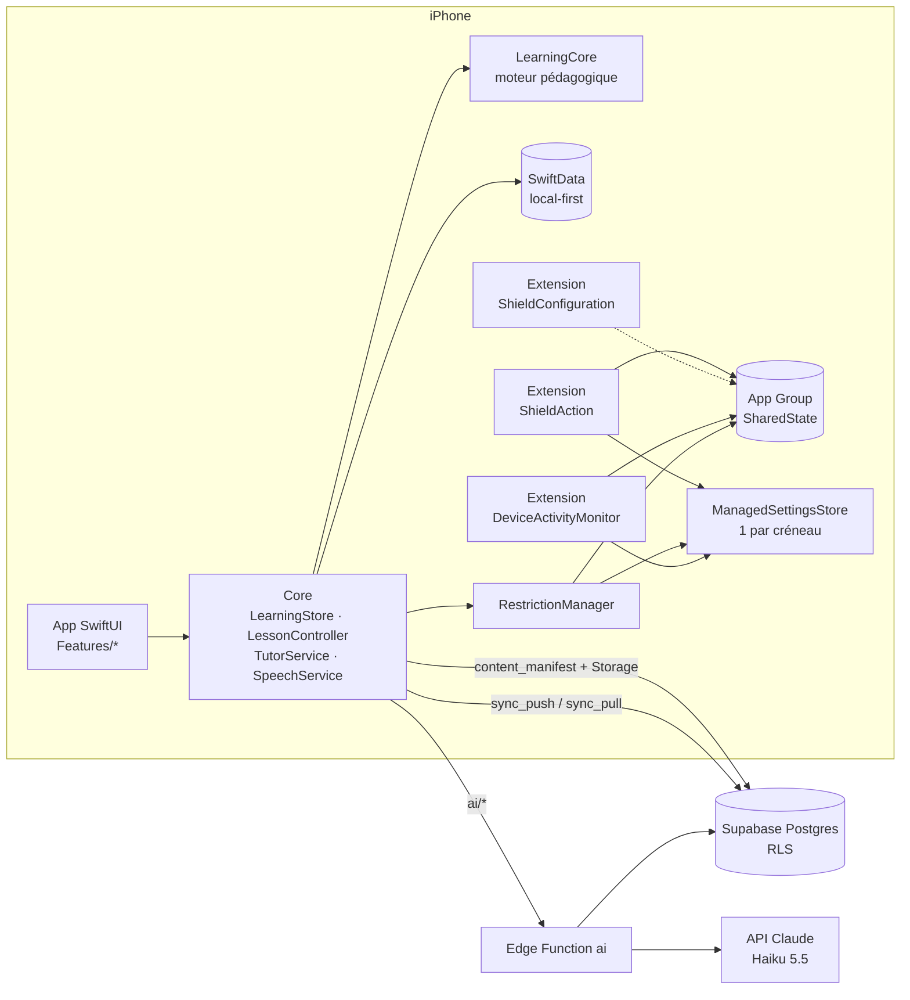

# Architecture technique

## Vue d'ensemble

Principes :

- **Le moteur pédagogique est indépendant de l'interface** (§21). `LearningCore` ne dépend que de Foundation, compile sur iOS, macOS et Linux, et se teste sans simulateur.
- **Local d'abord** (§2.3). Chaque réponse est corrigée et enregistrée localement, sans réseau. Le serveur sert à la sauvegarde, à la synchronisation entre appareils et à l'IA.
- **Les restrictions sont locales** (§6). Le serveur ne peut ni activer ni lever un blocage : c'est iOS, via DeviceActivity et ManagedSettings, qui applique les boucliers.
- **L'IA ne voit que le nécessaire** (§10.3, §20.3). L'app envoie des identifiants (exercice, notion, mot) et la réponse ; le serveur recharge le contenu validé depuis la base. La clé API reste sur le serveur.

## Modules

### LearningCore (`Packages/LearningCore`)

| Produit | Contenu |
|---|---|
| `LearningPrimitives` | Types partagés avec les extensions : `SessionSlot`, `LocalDay`, `TimeOfDay`, `DailySchedule`. Minuscule, car la mémoire des extensions est limitée |
| `LearningCore` | Modèle de contenu, `ContentIndex`, correction (normalisation, contractions, fautes de frappe, catégories d'erreurs), FSRS-4.5 adapté, maîtrise, choix de leçon et prérequis, planification des sessions, `SessionRunner`, diagnostic adaptatif, dictionnaire, progression |

La façade publique est `API/EngineAPI.swift`. Le détail des algorithmes est dans [05-moteur-pedagogique.md](05-moteur-pedagogique.md).

### App iOS (`App/Sources`)

| Dossier | Rôle |
|---|---|
| `App/` | `QuinzeApp` (point d'entrée, liens profonds, cycle de vie), `RootView` (chargement → compte → onboarding → accueil) |
| `Core/` | `AppEnvironment` (conteneur de dépendances), `LearningStore` (état du jour, sessions, dictionnaire, progrès), `LessonController` (déroulé d'une session), `TutorService`, `SpeechService` |
| `Services/` | Client Supabase, authentification (Apple, e-mail), persistance SwiftData, synchronisation, mise à jour du contenu, client IA, solutions de repli hors ligne, réglages |
| `Features/` | Écrans : onboarding (8 étapes), comptes, accueil, leçon (6 types d'exercices, correction, fin), professeur IA, dictionnaire, progrès, réglages |
| `ScreenTime/` | `RestrictionManager` (autorisation, sélection, planification, levée, secours, réconciliation), `AppSelectionView` |
| `Notifications/` | `NotificationScheduler` (plan sur 7 jours, rappels, confirmations, alerte d'autorisation) |
| `DesignSystem/` | Thème (couleurs adaptatives, typographie Dynamic Type), composants |

Architecture MVVM : les vues SwiftUI lisent des objets `@Observable` (`LearningStore`, `LessonController`…) annotés `@MainActor`. La logique métier est dans `LearningCore` et dans des fonctions pures de `Services/` (`SlotLogic`, `SnapshotBuilder`, DTO de synchronisation), testées unitairement.

### Screen Time (`Shared/`, `Extensions/`)

- **Un créneau = une activité DeviceActivity et un `ManagedSettingsStore` nommé.** Terminer la leçon du matin ne lève que le bouclier du matin.
- **Intervalle surveillé** : de l'heure de la leçon jusqu'à cette heure plus la fenêtre de sécurité (2 h par défaut, de 15 min à 4 h). Ainsi, `intervalDidEnd` lève toujours le bouclier, même si l'app n'est jamais ouverte. Une restriction ne reste jamais active indéfiniment.
- **`SharedState`** est un état versionné, stocké dans les UserDefaults de l'App Group. Il contient la sélection d'apps (jetons opaques, jamais synchronisés), le mode, les horaires et, pour chaque jour et chaque créneau, l'état (actif, terminé, expiré, levé en secours).
- **`SlotEngine`** regroupe la logique de décision commune à l'app et aux extensions, testée unitairement.
- **Déblocage d'urgence** : toujours disponible, depuis l'app et depuis le bouton secondaire de l'écran de blocage.

Les limites d'Apple, le protocole de prototype et les risques sont dans [02-faisabilite-apple.md](02-faisabilite-apple.md).

### Backend (`supabase/`)

- **Postgres** : tables de contenu (lecture seule), tables utilisateur protégées par RLS (`user_id = auth.uid()`), triggers `server_updated_at` qui servent de curseur de synchronisation.
- **RPC** : `sync_push` (idempotent ; le dernier `updated_at` client gagne), `sync_pull` (depuis un curseur ; restauration complète sur un nouvel iPhone), `content_manifest`.
- **Edge Function `ai`** : explication d'une réponse, d'un mot ou d'une règle ; questions de suivi ; notation des réponses libres. Elle inclut un cache, des quotas par utilisateur, un plafond mensuel global et une réponse de secours construite à partir du contenu validé.
- **Edge Function `account`** : export RGPD et suppression du compte.

Voir [03-base-de-donnees.md](03-base-de-donnees.md) et [04-api.md](04-api.md).

## Flux principaux

**Une session.**

1. L'utilisateur touche « Commencer ». `LearningStore` construit un `LearnerSnapshot` à partir de SwiftData, et `LearningEngine.planSession` produit 8 à 12 exercices et des cartes de règle ou de mot.
2. Pour chaque réponse, `evaluate` corrige localement (niveau 1). Si la correction est incertaine et que l'appareil est en ligne, `ai/grade-answer` tranche (niveau 2) ; sinon la tentative reste « en attente » et sera notée plus tard (niveau 3).
3. La tentative et les états de mémoire mis à jour sont enregistrés immédiatement. Après une erreur, un exercice similaire est ajouté en fin de session.
4. À la fin : la session passe à `completed`, la leçon est marquée apprise, `RestrictionManager.sessionCompleted` lève le bouclier du créneau, les rappels du créneau sont supprimés et la synchronisation est lancée.

**Horaire de leçon atteint, app fermée.** iOS réveille l'extension `QuinzeMonitor` (`intervalDidStart`). Si la leçon du créneau n'a pas déjà été faite en avance, l'extension applique le bouclier et note son échéance. Si l'utilisateur ouvre une app restreinte, il voit l'écran de blocage de `QuinzeShieldConfiguration`. À la fin de la fenêtre, `intervalDidEnd` lève le bouclier dans tous les cas.

**Nouvel iPhone.** Après la connexion, `sync_pull` avec un curseur à zéro restaure le niveau, les leçons, les états de mémoire, le vocabulaire, les sessions et les tentatives récentes. L'autorisation Screen Time et la sélection d'apps sont à refaire, car Apple ne permet pas de les transférer.

## Choix techniques

| Choix | Raison |
|---|---|
| Swift 6, SwiftUI, iOS 17 minimum | SwiftData et `@Observable` ; concurrence stricte |
| XcodeGen (`project.yml`) | Projet Xcode reproductible et lisible, généré en CI, pas de `.xcodeproj` versionné |
| SwiftData avec des blobs JSON pour les types riches | Robustesse et migrations simples ; les champs scalaires indexés servent aux requêtes |
| Supabase (Postgres, Auth, Edge Functions, Storage) | Conforme au cahier des charges ; RLS ; Sign in with Apple natif |
| FSRS-4.5 | Algorithme de répétition espacée documenté et moderne, adapté au type d'exercice |
| Claude Haiku 5.5 côté serveur | Coût très bas par explication ; le modèle se change par variable d'environnement |
| Corpus en JSON source, validé et compilé en un bundle | Relecture humaine facile, validation automatique, mise à jour du contenu sans nouvelle version de l'app |
