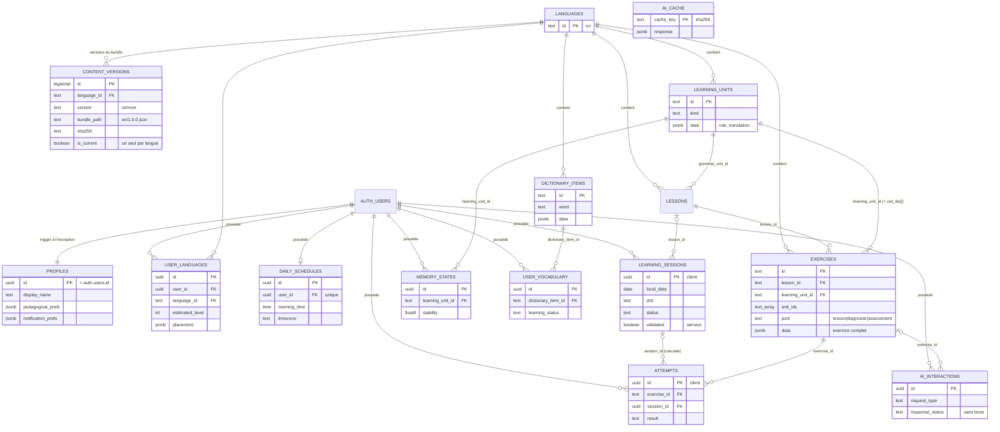

# 03 — Base de données (Supabase / PostgreSQL)

Ce document décrit le schéma de la base du backend de Quinze, ses règles de sécurité (RLS), son modèle de synchronisation hors ligne, le versionnement du contenu pédagogique et la rétention des données. Le contrat d'interface avec l'app iOS est dans `docs/contracts/backend.md` ; la référence des endpoints est dans `docs/04-api.md`.

Sources : `supabase/migrations/` (7 fichiers numérotés, appliqués dans l'ordre), `supabase/seed/`, tests dans `supabase/tests/`.

## 1. Vue d'ensemble

- **PostgreSQL géré par Supabase** (testé sur PostgreSQL 16, cible Supabase = 15 ou 17) : tables du schéma `public`, helpers dans le schéma `private` (non exposé par l'API).
- **Auth** : Supabase Auth (`auth.users`). Chaque table utilisateur référence `auth.users(id) ON DELETE CASCADE` : supprimer le compte supprime toutes ses données.
- **App hors ligne d'abord** : tout est écrit localement (SwiftData) puis synchronisé par les RPC `sync_push` / `sync_pull`. Les identifiants des tentatives et des sessions sont des UUID **générés par le client** : un renvoi du même lot est idempotent.
- **Contenu pédagogique** : tables en lecture seule pour les utilisateurs authentifiés, alimentées par un seed généré (`supabase/seed/content_en.sql`) ; le bundle JSON complet (`Content/build/en.json`) est publié dans le bucket Storage public `content`.
- **IA** : la fonction Edge `ai` s'appuie uniquement sur ce contenu validé ; `ai_interactions` (quota + observabilité, sans texte) et `ai_cache` (réponses partagées) sont accessibles par le service role seul (lecture de ses propres lignes d'`ai_interactions` pour l'utilisateur).

| Migration | Contenu |
|---|---|
| `20261014000001_extensions_helpers.sql` | `pgcrypto`, schéma `private`, utilitaires (`iso`, conversions tolérantes `try_*`, tableaux JSON) |
| `20261014000002_content_tables.sql` | `languages`, `content_versions`, `learning_units`, `lessons`, `exercises`, `dictionary_items` + index + trigger de version courante |
| `20261014000003_user_tables.sql` | `profiles`, `user_languages`, `daily_schedules`, `learning_sessions`, `attempts`, `memory_states`, `user_vocabulary`, `ai_interactions`, `ai_cache` + contraintes + index |
| `20261014000004_triggers.sql` | profil à l'inscription, `updated_at`/`server_updated_at`, dernière-écriture-gagne, immuabilité des tentatives, anti-fraude `validated` |
| `20261014000005_rls.sql` | RLS sur toutes les tables, révocation des droits par défaut, policies |
| `20261014000006_rpc_sync.sql` | `sync_push`, `sync_pull`, `content_manifest` |
| `20261014000007_ai_storage_maintenance.sql` | `ai_cache_get`, `ai_purge`, bucket Storage `content` + policy de lecture publique |

## 2. Schéma

### 2.1 Diagramme entité-relation



### 2.2 Tables de contenu (lecture seule)

| Table | Clé | Colonnes principales | Remarques |
|---|---|---|---|
| `languages` | `id` (`en`) | `code` unique, `name`, `native_name`, `writing_direction` (`ltr`/`rtl`), `tts_locale`, `is_available` | |
| `content_versions` | `id` bigserial | `language_id`, `version` (semver), `bundle_path`, `sha256` (64 hex), `published_at`, `is_current` | unique `(language_id, version)` ; **un seul `is_current` par langue** (index unique partiel + trigger) |
| `learning_units` | `id` | `language_id`, `kind`, `category`, `title`, `difficulty`, `prerequisites[]`, `module`, `data` jsonb, `content_version`, `deprecated` | `data.rule` = règle validée (résumé, explication, schéma, exemples, erreurs courantes) utilisée par le professeur IA |
| `lessons` | `id` | `module`, `title`, `description`, `difficulty`, `sequence_order`, `grammar_unit_id`, `introduces[]`, `reviews[]`, … | unique `(language_id, sequence_order)` |
| `exercises` | `id` | `lesson_id` (nul pour diagnostic/évaluation), `learning_unit_id` (unité principale), `unit_ids[]`, `exercise_type`, `pool`, `question`, `accepted_answers[]`, `explanation`, `difficulty`, `data` jsonb (exercice complet), … | `learning_unit_id` ∈ `unit_ids` (check) ; `data` contient `prompt`, `answer`, `acceptedAnswers`, `explanation`, `tip`, `extraExample`, `errorPatterns`… |
| `dictionary_items` | `id` | `word`, `translation`, `definition`, `examples` jsonb, `pronunciation`, `data` jsonb | index `(language_id, lower(word))` |

Les clés étrangères entre tables de contenu sont `DEFERRABLE INITIALLY DEFERRED` : le seed (une transaction) peut les insérer dans n'importe quel ordre, l'intégrité est vérifiée au `COMMIT`.

### 2.3 Tables utilisateur

Toutes portent `user_id uuid NOT NULL DEFAULT auth.uid() REFERENCES auth.users ON DELETE CASCADE` (sauf `profiles.id`). Colonnes de synchronisation : `updated_at` (horloge **client**), `server_updated_at` (horloge **serveur**, posée par trigger).

| Table | Clé / unicité | Colonnes (hors synchro) |
|---|---|---|
| `profiles` | `id` = `auth.users.id` | `email` (recopié depuis auth), `display_name` (≤ 80), `pedagogical_prefs`, `notification_prefs` (jsonb objet ≤ 16 Ko), `created_at`, `updated_at` (serveur) |
| `user_languages` | unique `(user_id, language_id)` | `estimated_level`, `start_lesson_sequence`, `placement` jsonb (résultat du diagnostic), `started_at` |
| `daily_schedules` | unique `user_id` | `morning_time`, `afternoon_time`, `evening_time` (time), `timezone` (IANA, validé), `enabled`, `safety_window_minutes` (0–1440), `early_start_minutes` (0–1440) |
| `learning_sessions` | `id` (UUID client) ; unique partiel `(user_id, language_id, local_date, slot)` si `slot` non nul | `session_type`, `slot` (`morning`/`afternoon`/`evening`/null), `local_date`, `scheduled_at`, `started_at`, `completed_at`, `status`, `lesson_id`, `item_count`, `correct_count`, `duration_seconds`, `score`, `emergency_unlocked`, **`validated`** |
| `attempts` | `id` (UUID client) | `language_id`, `exercise_id` → `exercises`, `session_id` → `learning_sessions` (cascade), `unit_ids[]`, `exercise_type`, `presentation`, `submitted_answer` (≤ 2000), `result`, `error_category`, `hint_used`, `is_remediation`, `duration_ms`, `answered_at` |
| `memory_states` | unique `(user_id, learning_unit_id)` | `language_id`, `stability`, `difficulty`, compteurs (`review_count`, `lapse_count`, `success_count`, `failure_count`, `no_hint_success_count`, `delayed_success_count`, `production_success_count`), `successful_exercise_types[]`, `recent_results boolean[]` (≤ 100), `source`, `first_seen_at`, `last_review_at`, `next_review_at` |
| `user_vocabulary` | unique `(user_id, dictionary_item_id)` | `added_at`, `learning_status` (`learning`/`known`/`mastered`) |
| `ai_interactions` | `id` | `user_id`, `exercise_id` (nul si sans objet), `request_type`, `response_status` (`ok`/`cached`/`fallback`/`rate_limited`/`error`), `model`, `input_tokens`, `output_tokens`, `latency_ms`, `created_at` — **jamais** de texte ni de donnée personnelle |
| `ai_cache` | `cache_key` (sha256 hex) | `request_type`, `response` jsonb, `model`, `created_at`, `hit_count`, `last_hit_at` — aucune donnée personnelle (la clé n'inclut pas d'identifiant d'utilisateur) |

### 2.4 Contraintes notables

- **Énumérations** (`CHECK`) : `status`, `slot`, `result`, `source`, `learning_status`, `pool`, `writing_direction`, `request_type`, `response_status`. `session_type` et `error_category` sont validés par format (`^[a-z][a-z_]{0,39}$`) plutôt que par liste fermée, pour ne pas rejeter une valeur ajoutée côté client.
- **Bornes** : compteurs ≥ 0, `duration_seconds` ∈ [0, 86400], `safety_window_minutes` et `early_start_minutes` ∈ [0, 1440], `recent_results` ≤ 100 éléments, taille des jsonb de préférences et de `placement` bornée.
- **Fuseau horaire** : `daily_schedules.timezone` doit exister dans `pg_timezone_names` (trigger).
- **Intégrité référentielle** : `attempts.exercise_id`, `memory_states.learning_unit_id`, `user_vocabulary.dictionary_item_id` → contenu ; `learning_sessions.lesson_id` → `lessons` (`ON DELETE SET NULL`) ; `attempts.session_id` → `learning_sessions` (`ON DELETE CASCADE`).
- **Index** : un index `(user_id, language_id, server_updated_at)` par table synchronisée (curseur de `sync_pull`), index sur chaque clé étrangère, `attempts (user_id, language_id, answered_at desc)`, index partiel du budget mensuel IA (`ai_interactions (created_at) WHERE response_status IN ('ok','fallback') AND model IS NOT NULL`).

## 3. Sécurité : RLS et privilèges

Les droits par défaut de Supabase (tout pour `anon`/`authenticated`) sont **révoqués**, puis accordés au plus juste. RLS est activée sur **toutes** les tables de `public` (vérifié par un test). `service_role` contourne la RLS (Edge Functions, seed).

| Table | `anon` | `authenticated` | Policies (rôle `authenticated`) |
|---|---|---|---|
| `languages`, `content_versions`, `learning_units`, `lessons`, `exercises`, `dictionary_items` | rien | `SELECT` | `USING (true)` — lecture seule |
| `profiles` | rien | `SELECT`, `UPDATE (display_name, pedagogical_prefs, notification_prefs)` | `id = auth.uid()` ; pas d'`INSERT` (trigger), pas de `DELETE` (suppression du compte), `email` non modifiable |
| `user_languages`, `daily_schedules`, `learning_sessions`, `memory_states`, `user_vocabulary` | rien | `SELECT/INSERT/UPDATE/DELETE` | `user_id = auth.uid()` (`USING` et `WITH CHECK`) |
| `attempts` | rien | idem | idem + `WITH CHECK` : la `session_id` référencée doit appartenir à l'utilisateur |
| `ai_interactions` | rien | `SELECT` | `user_id = auth.uid()` ; écriture par le service role uniquement |
| `ai_cache` | rien | rien | RLS activée **sans policy** : service role uniquement |

- **RPC** : `sync_push`, `sync_pull`, `content_manifest` sont `SECURITY INVOKER` (la RLS s'applique à chacune de leurs lectures/écritures), `search_path` vide, `auth.uid()` vérifié explicitement ; `EXECUTE` retiré à `public`/`anon`. `ai_cache_get` et `ai_purge` sont réservées au `service_role`.
- **Pas de `SECURITY DEFINER` exposé** : les deux seules fonctions `DEFINER` sont les triggers sur `auth.users` (création du profil, recopie de l'e-mail), `search_path = ''`, `EXECUTE` révoqué.
- **Colonnes protégées** : `server_updated_at` et `validated` sont recalculés par trigger quelle que soit la valeur envoyée ; `user_id`, `id` (et `language_id` des sessions) ne peuvent pas être modifiés par un `UPDATE`.
- **Storage** : bucket `content` public en lecture (`GET /storage/v1/object/public/content/<chemin>`), aucune policy d'écriture : seul le service role (ou le tableau de bord) peut déposer un bundle.
- **Schéma `private`** : non exposé (`api.schemas = ["public","graphql_public"]`).

## 4. Modèle de synchronisation

### 4.1 Deux horloges

- `updated_at` : horloge de l'iPhone, **uniquement** pour départager deux versions d'une même ligne.
- `server_updated_at` : posée par le serveur (`clock_timestamp()` dans un trigger) à chaque écriture ; le client ne peut pas la choisir. C'est le curseur de `sync_pull`.

### 4.2 `sync_push`

Une transaction, dans l'ordre : sessions → attempts → memory_states → vocabulary.

| Entité | Règle |
|---|---|
| `learning_sessions` | `INSERT … ON CONFLICT (id) DO UPDATE … WHERE excluded.updated_at > existant.updated_at` : la ligne entrante gagne **seulement** si son `updated_at` est strictement plus récent. |
| `memory_states`, `user_vocabulary` | idem, clé `(user_id, learning_unit_id)` / `(user_id, dictionary_item_id)`. |
| `attempts` | **Immuables** : `ON CONFLICT DO NOTHING`. Seules exceptions : `result`/`error_category` d'une tentative `pending` (résolution IA, si `updated_at` plus récent) et `session_id` tant qu'il est nul (rattachement tardif). Toute autre modification est refusée par trigger (`42501`). |

- **Idempotence** : renvoyer le même lot ne modifie aucune ligne (pas d'écriture → `server_updated_at` inchangé → aucun écho inutile) et renvoie les mêmes compteurs.
- **Références inconnues** : un exercice, une unité ou un mot absent du serveur (ou d'une autre langue) → ligne ignorée et comptée dans `rejected`. Une `lesson_id` inconnue de session est simplement mise à `null` (la session est conservée). Une `session_id` d'attempt inconnue ou appartenant à un autre utilisateur est mise à `null`.
- **Lignes mal formées** (UUID invalide, énumération hors liste, date illisible…) : rejetées et comptées, sans faire échouer le lot. Les erreurs de forme du lot lui-même (pas un objet, `language_id` inconnu, tableau attendu) sont des erreurs `22023` ; plus de 5000 attempts / 1000 sessions / 2000 memory_states / 2000 vocabulary → `PT413` (HTTP 413).
- **Même créneau, autre UUID** (deux appareils) : l'index unique `(user_id, language_id, local_date, slot)` interdit deux sessions pour un créneau. La session du serveur est conservée, la session entrante est comptée dans `rejected.sessions`, et les tentatives du même lot qui la référençaient sont **rattachées à la session existante**.
- **Collision d'UUID avec un autre utilisateur** : jamais écrasée (RLS) ; comptée comme rejetée (sessions) ou ignorée (attempts).
- **Doublons dans un lot** : dédoublonnés (le plus récent gagne).

### 4.3 Anti-fraude `validated`

Une session de type `learning`, `application` ou `consolidation` passée à `completed` avec **moins de 4 tentatives** associées est conservée mais `validated = false` : elle ne compte pas dans les statistiques serveur. Le calcul est fait **côté serveur** :

- à chaque `INSERT`/`UPDATE` de session (trigger `BEFORE`), et
- après chaque insertion/mise à jour de tentatives (trigger `AFTER … FOR EACH STATEMENT`) : si les tentatives arrivent après la session (même lot ou plus tard), `validated` est recalculé et repasse à `true` dès la quatrième.

Le client ne peut pas forcer la valeur. Le déblocage Screen Time est **local** et ne dépend jamais du serveur.

### 4.4 `sync_pull` et curseur

`sync_pull(p_language_id, p_since)` renvoie ce dont `server_updated_at > p_since` (`'1970-01-01'` = restauration complète), filtré par langue :

- `sessions`, `memory_states`, `vocabulary` : sans plafond ; `attempts` : les **2000 plus récentes** (par `answered_at`).
- `user_language` et `schedule` : `null` s'ils n'existent pas **ou n'ont pas changé depuis `p_since`**.
- `server_time` = prochain `p_since`. Il est volontairement **en retrait de 2 secondes** sur l'horloge du serveur (et ne recule jamais sous `p_since`) : une transaction concurrente validée juste après la lecture ne peut pas être manquée. Contrepartie : une ligne peut être renvoyée deux fois, ce que la fusion idempotente du client absorbe.

### 4.5 Écritures directes (PostgREST)

`profiles`, `user_languages` (`on_conflict=user_id,language_id`) et `daily_schedules` (`on_conflict=user_id`) s'écrivent directement. Les mêmes triggers s'appliquent : `server_updated_at` est posé par le serveur et un `updated_at` plus ancien que la ligne en base est **ignoré silencieusement** (dernière écriture gagne). À égalité d'`updated_at`, une écriture directe est appliquée alors que `sync_push` n'écrit pas (idempotence).

## 5. Versionnement du contenu

- `content_versions` historise les bundles publiés (`version` semver, `bundle_path` = `<langue>/<version>.json`, `sha256` du fichier). Un trigger garantit **une seule version courante par langue** : insérer une version `is_current` rétrograde la précédente ; insérer une `(langue, version)` déjà connue la **met à jour** (le seed généré est donc rejouable tel quel).
- Le client appelle `content_manifest(p_language_id)` → `{version, bundle_path, sha256, published_at}` (ou `null`), compare à sa version locale, télécharge `GET /storage/v1/object/public/content/<bundle_path>` et vérifie le `sha256`.
- Identifiants d'exercices, d'unités, de leçons et de mots **stables entre versions** : les données utilisateur déjà synchronisées restent valides. Un élément retiré est marqué `deprecated`, jamais supprimé (`attempts`, `memory_states`, `user_vocabulary` le référencent).
- `learning_units.content_version`, `exercises.content_version` et `dictionary_items.content_version` portent la version qui a écrit la ligne. Elle entre dans la clé du cache IA : publier une nouvelle version du contenu invalide naturellement les explications mises en cache.
- Procédure de publication : `docs/06-deploiement-backend.md` § 7 et `supabase/seed/seed.sql`.

## 6. Rétention, RGPD, sauvegardes

| Donnée | Conservation | Mécanisme |
|---|---|---|
| Données d'apprentissage et de compte (profil, sessions, tentatives, états mémoire, vocabulaire, préférences) | Tant que le compte existe | Suppression en cascade avec `auth.users` |
| `ai_interactions` (métadonnées techniques, sans texte) | 90 jours glissants (minimum 62 pour le plafond mensuel) | `public.ai_purge()` planifiée ; supprimées aussi avec le compte |
| `ai_cache` (réponses partagées, sans donnée personnelle) | 180 jours sans accès | `public.ai_purge()` |
| Bundles de contenu (Storage) | Toutes versions | Manuel |
| Sauvegardes Supabase | Selon l'offre (voir `docs/06-deploiement-backend.md` § 9) | Une suppression de compte disparaît des sauvegardes à leur expiration |

- **Droit à l'effacement** : `DELETE /functions/v1/account` supprime l'utilisateur Auth ; la cascade supprime toutes ses lignes (testé sur toutes les tables, le contenu et le cache restent intacts).
- **Droit d'accès / portabilité** : `GET /functions/v1/account/export` (JSON complet).
- **Minimisation IA** : ni e-mail, ni nom, ni identifiant d'utilisateur n'est envoyé au fournisseur ; `ai_interactions` ne stocke ni réponse ni question ; le cache n'est pas lié à l'utilisateur.
- **Planifier la purge** (extension `pg_cron`, à activer dans Database > Extensions) :

```sql
select cron.schedule('quinze-ai-purge', '17 3 * * *', $$select public.ai_purge(90, 180)$$);
```

## 7. Tests

`supabase/tests/run_sql_tests.sh` crée un cluster PostgreSQL 16 jetable (utilisateur système `pgtest`, port libre, répertoire temporaire), installe un faux environnement Supabase (`tests/sql/00_supabase_stub.sql` : rôles, `auth.users`, `auth.uid()`, `storage.*`), applique les migrations, charge **deux fois** le seed réel puis exécute `tests/sql/1x–3x` :

- `10_rls_isolation.sql` — RLS (select/insert/update/delete entre deux utilisateurs), privilèges `anon`, `ai_cache`, contenu en lecture seule, immuabilité des tentatives, anti-fraude, unicité de créneau, contraintes, dernière écriture gagne en écriture directe ;
- `20_sync.sql` — `sync_push` (idempotence, LWW, références inconnues, lignes mal formées, conflit de créneau, isolation), `sync_pull` (restauration complète, curseur, plafond de 2000, formats de date), `content_manifest` ;
- `30_content_cascade.sql` — intégrité du contenu réel, versions de contenu, Storage, suppression de compte en cascade, rétention.
